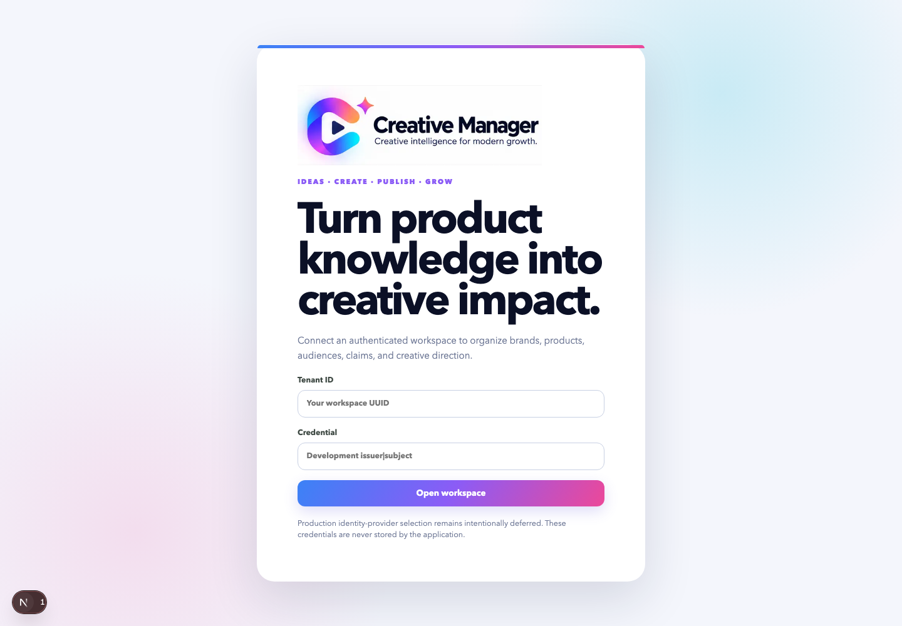
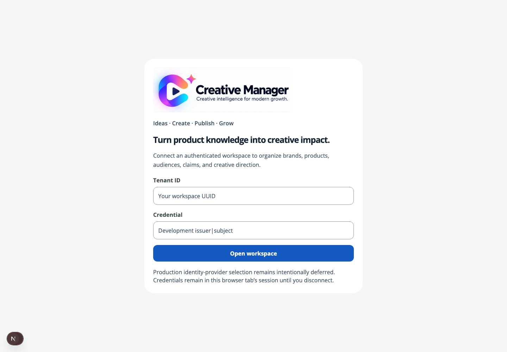

# Creative Manager 2026: baseline and design contract

Status: Phase 0 audit and Phase 1A visual foundation. The full upgrade is **not complete**.
Audited 2026-10-31 against main `0af3bf2552aadc6ecab5dbca7ed44adfc85943ad`.
Baseline CI: https://github.com/henbranz/Creative-Marketer/actions/runs/38651921849 (success).

## Evidence and safety

Read AGENTS, product vision, system constitution, master brief, research notes, and ADRs
009, 024, 026, 028, 030, 037, 038, 044 and 057. Inspected the sole Next route `/`, all
workspace panels, generated API contracts, Catalog revision semantics, AgentRuntime,
and Assembly boundaries. Repository migration head is `20261016_0040`; no migration ran.
The working tree had unrelated `apps/web/next-env.d.ts`, `.env†`, `creative manager/`,
and the user-supplied upgrade pack. These are not implementation changes.

Baseline frontend: 82 tests passed. Existing CI is evidence for the baseline, not a
claim that new work has passed. New work must pass its own PR CI before main changes.

Browser captures use an isolated context, reduced motion, settled fonts/network,
1440/1280/768/390px widths and 1000px viewport height. All non-GET/HEAD/OPTIONS requests
and non-loopback hosts are blocked. No approval, save, generation, publishing, or
rerender button is activated. Baseline screenshots are observations, not proof of
every interaction's correctness. Local audit captures live product content; do not
upload screenshots containing credentials, signed URLs, or confidential content to
public services.

**Brief conflict:** `make live-next` is not strictly read-only. `live_next()` can create
or update StateStore checkpoints even without explicit approval. `session_status()`
can bind recovery successors too. Neither is run as a baseline command. Inspect
bounded GET responses and existing checkpoint IDs instead; do not modify session data.

Read-only API inspection confirms the canonical product has an approved production
plan and seven READY Assets (five video, two image). This audit does not regenerate
any of them or certify current historical state from a partially loaded UI.

## Screen inventory and prioritized findings

All panels currently live in `apps/web/src/product-workspace.tsx`; they are local
React state, not independently addressable routes. Back/forward/deep linking is a
separate behavior change, not something CSS can fix.

| Surface | Baseline evidence / issue | Proposed treatment | Priority |
| --- | --- | --- | --- |
| Access `/` | Oversized marketing heading; tenant/token entry; copy says credentials never stored but sessionStorage is used | Compact access form; truthful session copy; production IdP remains separate | P1 |
| Product catalog / create dialogs | Oversized hero and metric cards, duplicated creation actions | Product list with concise brand grouping; preserve both create contracts | P2 |
| Shared shell | 248px primary rail + 218px product rail + gutters; tiny text; purple gradients; tabs don't update URL | Compact neutral rail, useful content width, 44px targets; later URL state adapter | P1 |
| Overview | Many empty cards; snapshot/readiness dominate visual weight | Facts as compact rows; media and next governed action prominent | P2 |
| Brief | Six sections with >7 real prompts; 86% server readiness is not questionnaire progress; local draft only | Seven answers, separately labeled readiness, server draft CAS, explicit Apply | P0 |
| Brief mobile | Later desktop CSS overrides earlier mobile grid: three columns squeeze the textarea and readiness overlaps | Correct responsive cascade immediately, before changing question semantics | P0 |
| Claims | Human authority editor already isolated; brand-wide scope warning matters | Preserve confirmation and scope; align typography, never auto-promote research claims | P0 preserve |
| Assets | Image/video previews are I/V letters; long names overflow; separate-window Preview | Authenticated lazy thumbnails/player, refreshable grants, keyboard lightbox, local upload preview | P1 |
| Research | Sources, social targets, evidence, run controls share long panel | Evidence list plus inspector; label untrusted/observed/inferred; intake is not another questionnaire | P1 |
| Creatives | Immutable concepts and decisions; no persisted ranking assessment | Side-by-side ranked evidence and heuristic rubric; no success probability | P1 |
| Production | Story/segments, jobs, plan approval, Assembly and Finals all share panel | Editable draft storyboard + source inspector; immutably revised plans, separate free/paid actions | P1 |
| Assembly / Final review (Production) | Existing real motion renderer and rerender revisions work | Preserve renderer/source IDs/revision history; timeline becomes view over governed revisions | P0 preserve |
| Published | Publishing draft/review/account controls | Show platform authority and exact reviewed asset; no automatic publication | P0 preserve |
| Performance | Fake metrics adapter; empty states can be mistaken for integration readiness | Source/freshness/missingness first; separate owned paid, owned organic, competitor observation | P1 |
| Insights | Candidate hypotheses and experiments, not facts | Evidence inspector and trust labels; preserve append-only decisions | P1 |
| Commerce / Approvals | Commerce actions are a separate privilege boundary; global Approvals opens Commerce | Label scope accurately; never merge commerce mutation into creative approval | P1 |
| Command Center | Cycle controls, readiness, approvals and next-action guidance | One next action with cost/approval explanation; no hidden autonomous loop | P0 preserve |
| Agents / Activity / Settings | Disabled Soon entries, no separate implemented pages | Do not imply working destinations or remove capabilities; revisit navigation grouping | P2 |

## Proposed visual system: the creative workbench

A founder reviewing a cut on a laptop in daylight needs legible script, visible media,
and a clear next decision, not a marketing dashboard. Media is the expressive element;
the surrounding interface is quiet and precise. Keep the approved Creative Manager logo
unchanged. No new gradients, purple actions, emoji navigation, or decorative hero metrics.

| Token | Value / purpose |
| --- | --- |
| Canvas | `#f4f6f8` cool neutral workspace |
| Surface | `#ffffff` content / form surfaces |
| Muted surface | `#eaf0f5` selected groups |
| Ink | `#152334` primary text |
| Secondary | `#475569` readable secondary text |
| Action | `#145ac2` primary action / focus |
| Border | `#c4ced9` structural boundaries, not nested decoration |
| Type | Self-hosted Open Sans, `1rem` body, `1.5rem` heading; weights 400/600/700 |
| Spacing | 4 / 8 / 12 / 16 / 24px, grouped by task |
| Controls | At least 44px hit area; visible 3px focus ring; no hidden focus |
| Shape | 8px controls, 12px content surfaces; no default large shadow |

Two author-defined UI sizes are a rule, not two fixed device pixels: rem respects browser
text scaling. Heading tags remain semantic. Readiness, warnings, metadata and actions
use weight/layout, not microtext. Hebrew shaping, fallback coverage, native-language
QA and real 200% zoom remain explicit acceptance checks, not assumed from font choice.

```text
Desktop target
┌ Navigation ┬ Product / stage / saved status ────────────────┐
│ Products   │ Brief → Research → Concepts → Production …   │
│ Workspace  ├──────────────────────────┬────────────────────┤
│ Approvals  │ Primary work / media     │ Evidence / source  │
│            │ Seven-answer intake OR  │ provenance / cost  │
│            │ storyboard / asset grid │ contextual details │
└────────────┴──────────────────────────┴────────────────────┘
Mobile: one work column; navigation drawer; disclosures below work;
no three-column Brief, no inspector covering the answer.
```

Phase 1A deliberately does not collapse the product tree into a new selector yet:
that needs keyboard navigation, dirty-draft and route-restoration tests. It first
reclaims redundant padding, fixes the broken mobile grid and consolidates typography.

## Density measurement, not a marketing claim

The target is ~70% less unproductive blank canvas on comparable **real-content**
screens. Do not count useful media preview area as waste; exclude empty-state screens.
Use same product, viewport, expanded state, scroll position and data before/after.
Record content/rail/form bounding boxes, then annotate dead rectangles for review.
Do not claim the 70% goal from a smaller sidebar alone. This first slice establishes
the measurement harness; whole-product density acceptance remains open.

## Skill-informed choices

`frontend-design` informed a deliberate product-specific direction; UI UX Pro Max
confirmed focus/44px/readability constraints. Its design-system search returned a
landing-page hero and an alternative purple palette even after one narrower retry:
both are rejected as mismatches, not blindly persisted. The brief's Open Sans and
two-size requirement override suggested font pairings. Impeccable's Operate, distill
and polish guidance informs the manual review; automated detectors/hooks are not installed.
See `third-party-ui-skills.json` for exact source pins, licenses and limitations.

## Architectural decisions before subsequent slices

- Catalog owns a new per-tenant/product/authenticated-user draft aggregate; autosave
  must not call existing canonical `saveBrief()` or rotate Product snapshots.
- Draft schema v1 carries seven answer components, original full Brief payload,
  base source revision, draft revision, active step, confirmation/inference metadata.
  CAS conflicts require explicit compare/resolve; local recovery keys include user.
- Existing fields remain in a review sheet. Seven answers cannot safely populate
  every structured legal/rights field; inferred values need explicit review, never
  automatic approved claims. Keep the >=80 backend gate until a versioned ADR changes it.
- Creative ranking is a separate immutable assessment with evidence IDs/rubric/version;
  exclusion gates precede soft score. ProductClaimRefs remain exact snapshot identities.
- Producer edits are drafts and revisions, never in-place changes to approved plans.
  Existing-source trims/overlays rerender Assembly only; source generation changes
  require new route/cost/approval binding. Retain ADR-057 real FFmpeg and provider isolation.
- Metrics connectors use Measurement read ports, least-privilege OAuth and Tool Gateway;
  they do not inherit publishing authority. PyTorch extractors are optional, bounded,
  versioned jobs; tree training abstains without adequate consented outcome labels.

## External feasibility (documentation check, not account activation)

| Capability | Evidence / boundary | Dependency |
| --- | --- | --- |
| TikTok owned organic counts | [Official video object](https://developers.tiktok.com/docs/en/tiktok-api-v2-video-object) lists views/likes/comments/shares | Authorized account/scopes and successful real read; not full Studio analytics |
| Meta public ads | [Official Ad Library API](https://br-fr.facebook.com/ads/library/api/?source=onboarding) describes transparency search | Region/category/API access verification; no invented competitor ROAS |
| Hebrew narration | [Google voice list](https://docs.cloud.google.com/text-to-speech/docs/list-voices-and-types) lists he-IL Chirp3 HD | Explicit paid benchmark and native-speaker QA; docs do not establish quality |
| Owned paid metrics | Separate Meta Marketing / TikTok Business contracts | Current scopes/access/app approval verification before connector implementation |
| Own-voice conversion | Consent and exact model/locale capability required | Hebrew STS not assumed from TTS; transcript→TTS fallback must be labeled |
| Multimodal models | Research notes propose SigLIP2, multilingual text embeddings and trees | Weight licenses, Hebrew retrieval benchmark, CPU fallback; no weights downloaded here |

No connector is labeled verified/connected on documentation evidence alone.

## Phase 1A evidence and limitations

Changed runtime files: `app/layout.tsx`, `app/styles.css`, `src/ui/tokens.css`,
`src/ui/workbench.css`, `src/ui/components.tsx`, `src/product-workspace.tsx` under
`apps/web`. Added `workbench.test.tsx` and `scripts/ui-audit.mjs`. No API, database,
agent, workflow, provider, event, asset or approval contract changed.

Legacy CSS is enclosed in a named cascade layer so the small workbench layer has
predictable precedence. Prettier indents the old file; review its semantic changes
with `git diff -w`. Font-size consolidation is mechanical; logo assets are unchanged.

Public-safe access screen comparison (the repository is public):

| Before | Phase 1A |
| --- | --- |
|  |  |

Authenticated captures remain local because they contain private business content.
The first baseline capture includes premature empty states on some asynchronous
panels; those are **not valid before-state evidence** for Production/Research/Creatives.
The settled capture harness replaces timing guesses with a quiet API-read interval.
Brief/access baseline images were visually checked. A complete fixture-backed,
redistributable baseline and full interaction matrix remain a release dependency.

The harness blocks asset download-grant POSTs as well as mutations. Thus existing
automatic preview requests show unavailable media during this read-only audit;
this is not evidence that stored Assets are missing or broken. It never clicks
approval, save, generation or rerender actions. Development overlays may remain visible.

Run the operator-only harness with Playwright already installed, an authenticated
local API, `CM_TENANT_ID` / `CM_API_TOKEN` supplied through the approved dotenv loader,
`UI_AUDIT_PRODUCT_NAME`, and private `UI_AUDIT_OUTPUT`. Optional `PLAYWRIGHT_MODULE`
points at an existing module; nothing is auto-installed. Set
`UI_AUDIT_ASSERT_FOUNDATION=1` to check document overflow, 16/24px computed type at
default zoom, and absence of the legacy active-tab gradient. Never commit private
screenshots or pass credentials as command-line arguments.

Local validation: 90 frontend tests, lint, typecheck, formatting and generated-contract
check pass; backend non-service suite: 1208 passed, 1 skipped, 144 deselected.
The read-only browser assertions pass on 11 product tabs at all four widths (44
views): 16/24px computed type, no document overflow, no gradient active-tab border.
Brief answer widths are 794/634/710/332px at 1440/1280/768/390px respectively.
Full isolated service/container/Temporal/FFmpeg validation is delegated to PR CI,
not the live database. The PR's CI result is the authoritative merge gate.

Open acceptance: seven questions, server drafts, real Asset tiles, full 70% dead-space
measurement, real browser 200% zoom, native Hebrew/RTL QA, deeper panel extraction,
and remaining interaction states. No claim that Phase 1 or the overall upgrade is done.
